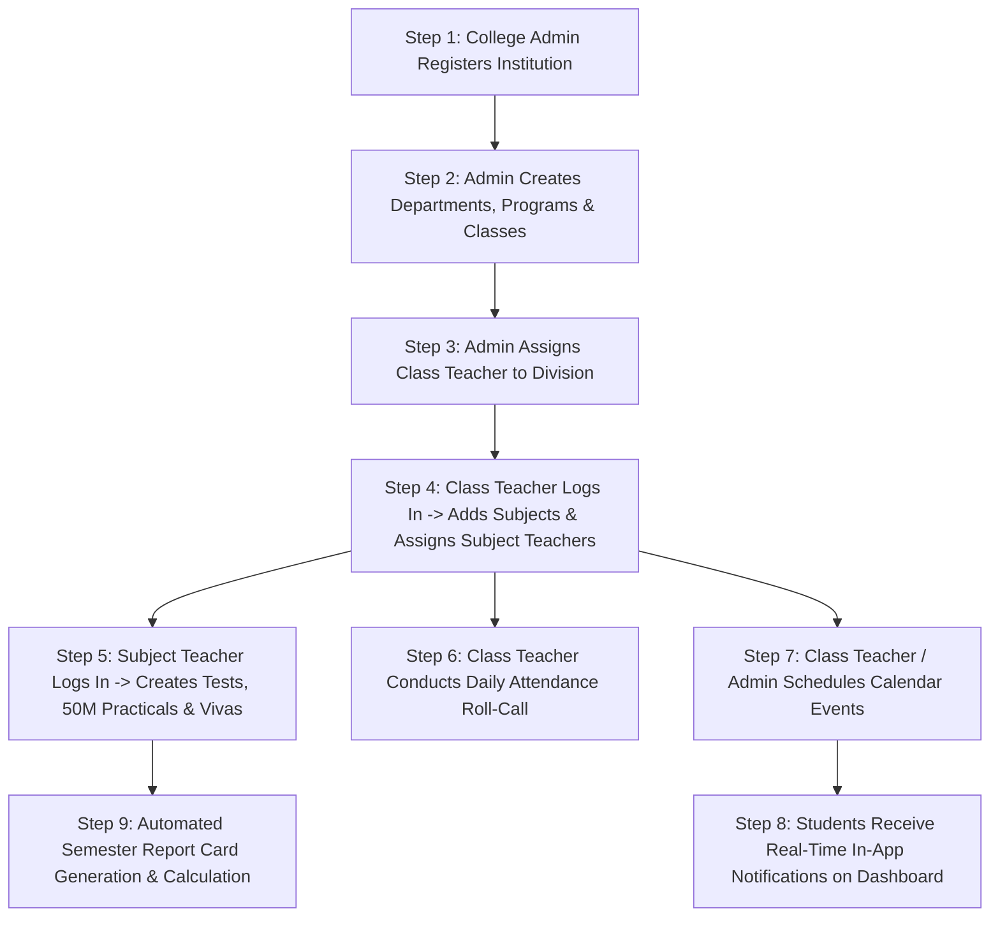

# ⛵ Paperboat Education ERP Platform
## Complete Process, Architecture & Operational Roadmap Guide

> **Official Enterprise Architecture & Workflow Manual**  
> *Paperboat Education Systems Inc. © 2026. All rights reserved.*  
> *Child Engine: ExamForge Assessment & Examination Engine.*

---

## 📑 Table of Contents
1. [Executive Overview & Platform Identity](#1-executive-overview--platform-identity)
2. [5 Independent Stakeholder Systems](#2-5-independent-stakeholder-systems)
3. [Step-by-Step End-to-End Operational Workflow](#3-step-by-step-end-to-end-operational-workflow)
   - [Step 1: College Onboarding & Tenant Provisioning](#step-1-college-onboarding--tenant-provisioning)
   - [Step 2: Institutional Setup (Departments, Programs & Classes)](#step-2-institutional-setup-departments-programs--classes)
   - [Step 3: Class Teacher Assignment (Admin Action)](#step-3-class-teacher-assignment-admin-action)
   - [Step 4: Curriculum Setup & Subject Teacher Assignment (Class Teacher Action)](#step-4-curriculum-setup--subject-teacher-assignment-class-teacher-action)
   - [Step 5: Test Creation, Practical Rubrics & Viva Scoring (Subject Teacher Action)](#step-5-test-creation-practical-rubrics--viva-scoring-subject-teacher-action)
   - [Step 6: Attendance Tracking & Daily Governance](#step-6-attendance-tracking--daily-governance)
   - [Step 7: Event Scheduling & Real-Time Student Notifications](#step-7-event-scheduling--real-time-student-notifications)
   - [Step 8: Final Report Cards & Semester Marksheets](#step-8-final-report-cards--semester-marksheets)
4. [Master Route Directory & System URLs](#4-master-route-directory--system-urls)
5. [Pre-Seeded Credentials Directory](#5-pre-seeded-credentials-directory)
6. [API Endpoints Reference](#6-api-endpoints-reference)
7. [Troubleshooting & Verification Commands](#7-troubleshooting--verification-commands)

---

## 1. Executive Overview & Platform Identity

**Paperboat** is a unified multi-tenant Education ERP and Academic Governance Platform designed for colleges, universities, and polytechnics. 

### Core Architectural Principle: *"Assignment Determines Access"*
Unlike legacy monolithic systems where teachers have broad, unpartitioned permissions:
- A faculty member assigned as a **Class Teacher** can only manage their assigned division's subjects, subject faculty roster, attendance records, and generate consolidated class report cards.
- A faculty member assigned as a **Subject Teacher** can only create assessments, record 50-mark practical rubrics, and grade viva/theory marks for their specific allocated subject and class division.
- **ExamForge** operates as the high-security, specialized child assessment engine powering time-bound tests, randomized question banks, CSV question ingestion, anti-cheat mechanisms, and cryptographic certificate generation.

---

## 2. 5 Independent Stakeholder Systems

Every stakeholder group operates in a dedicated, isolated workspace with independent authentication:

```
                                  ⛵ PAPERBOAT EDUCATION ERP
                                              │
         ┌──────────────────┬─────────────────┼──────────────────┬──────────────────┐
         │                  │                 │                  │                  │
         ▼                  ▼                 ▼                  ▼                  ▼
  🏛️ COLLEGE ADMIN    👩‍🏫 CLASS TEACHER   👨‍🏫 SUBJECT TEACHER    🎓 STUDENT      🛡️ SUPER ADMIN
  ────────────────    ────────────────   ──────────────────    ─────────      ───────────────
  • Tenant Setup      • Division In-Charge• Course In-Charge    • Timetable    • Multi-Tenant
  • Departments       • Add Subjects      • Create Tests (CSV)  • Take Exams   • Subscriptions
  • Programs & Years  • Assign Sub Faculty• 50M Practical Rubrics• In-App Alerts • System Auditing
  • Assign Class Tchrs• Attendance Roll   • Oral Viva Marks     • Report Cards • Telemetry
  • Code: STANFORD    • Final Gradecards  • Continuous Marks    • Submissions  • 2FA OTP Guard
```

---

## 3. Step-by-Step End-to-End Operational Workflow

Follow this precise sequential flow to configure and run any academic institution from scratch:



### Step 1: College Onboarding & Tenant Provisioning
1. Navigate to the **College Registration Portal** at `/college`.
2. Enter the College Name, official email, campus address, and Primary Administrator details.
3. Upon submission, the platform automatically generates an **Institute Secret Code** (e.g., `STANFORD-2026`).
4. Administrator credentials are immediately verified and tenant database partitioning is initialized.

### Step 2: Institutional Setup (Departments, Programs & Classes)
1. Navigate to **College Admin Sign-In** at `/college/login` (or `/login`).
2. Sign in using the **Institute Secret Code** (or admin email) and password (`Password@123`).
3. Under the **Academic Setup** tab:
   - Create Academic Departments (e.g., *Computer Science & Engineering*).
   - Create Degree Programs (e.g., *B.Tech CSE* - 4 Years / 8 Semesters).
   - Establish Active Academic Year (e.g., *2025-2026 - ODD Semester*).
   - Create Class Divisions (e.g., *BE-COMP-TE-A*).

### Step 3: Class Teacher Assignment (Admin Action)
1. Within the College Admin Dashboard (`/college/dashboard`), switch to the **Class Divisions** section.
2. Select a division (e.g., `BE-COMP-TE-A`).
3. Assign a faculty member from the verified roster as the designated **Class Teacher** (e.g., `Prof. Rahul Sharma`).
4. Click **"Save Class In-Charge Assignment"**.

### Step 4: Curriculum Setup & Subject Teacher Assignment (Class Teacher Action)
1. The assigned Class Teacher navigates to `/teacher` (or `/academic`) and logs in (`teacher.rahul@stanford.edu` / `Password@123`).
2. The dashboard detects their **Class Teacher** status and unlocks the **Class In-Charge Command Suite**:
   - Add new subjects to the division (e.g., *Cloud Infrastructure & Distributed Systems - CS-0586*).
   - Set Subject Type (*Theory*, *Practical*, *Viva*, or *Integrated*).
   - Assign dedicated **Subject Teachers** for each course component (e.g., `Prof. David Reynolds`).

### Step 5: Test Creation, Practical Rubrics & Viva Scoring (Subject Teacher Action)
1. The assigned Subject Teacher logs in at `/teacher` (`teacher.david@stanford.edu` / `Password@123`).
2. Under their assigned course dashboard:
   - **ExamForge Test Creator**: Create unit tests, scheduled term exams, and upload question banks via CSV.
   - **50M Practical Rubrics**: Enter continuous laboratory evaluations across standard parameters:
     - *Experiment Performance (20 Marks)*
     - *Laboratory Journal & Record (10 Marks)*
     - *Implementation & Coding (10 Marks)*
     - *Practical Viva Voce (10 Marks)*
   - **Continuous Assessment**: Record mid-term and internal evaluation marks.

### Step 6: Attendance Tracking & Daily Governance
1. The Class Teacher opens the **Attendance Module** in `/academic` or `/teacher`.
2. Select date and lecture slot.
3. Perform rapid student roll-call (*Present*, *Absent*, *Late*, *Excused*).
4. System automatically computes running attendance percentage and triggers low-attendance warnings if under 75%.

### Step 7: Event Scheduling & Real-Time Student Notifications
1. The Class Teacher or College Admin schedules an event via the **Calendar & Event Dispatcher**:
   - Event Types: *Exam/Test*, *Holiday*, *Seminar*, *Assignment Deadline*, *Cultural/Sports*.
   - Location, date, and description.
2. The system automatically creates **In-App Notification records** for all students actively enrolled in that class division.
3. When students log into `/student`, the bell icon displays unread alerts with direct action cards.

### Step 8: Final Report Cards & Semester Marksheets
1. Once continuous evaluations and exam marks are submitted, the Class Teacher opens **Report Cards**.
2. Click **"Compute & Generate Semester Marksheet"**.
3. System aggregates Theory marks, 50M Practical Rubrics, Viva scores, and Attendance into official printable PDF-ready gradecards with SGPA/CGPA calculations.

---

## 4. Master Route Directory & System URLs

| System / Role | Primary Route | Purpose |
| :--- | :--- | :--- |
| **Main Landing Page** | `/` | Platform introduction, brand identity, quick role gateways, theme switcher. |
| **Role Gateway Login** | `/login` | 1-Click role presets, fast authentication for all roles. |
| **College Onboarding** | `/college` | Institutional registration and Institute Secret Code generation. |
| **College Admin Login** | `/college/login` | Admin sign-in via Institute Secret Code or email. |
| **College Admin Dashboard**| `/college/dashboard` | Manage departments, programs, classes, faculty, student roster. |
| **Academic ERP Management**| `/academic` | High-level academic governance, class setup, and timetable controls. |
| **Faculty / Teacher Hub** | `/teacher` | Unified teacher portal (Class In-Charge + Subject In-Charge views). |
| **Student Learning Portal**| `/student` | Student dashboard, timetables, tasks, exam taking, report cards. |
| **Super Admin 2FA Login** | `/admin/login` | Cryptographic Zero-Trust 6-digit OTP verification. |
| **Super Admin Control** | `/admin` | Tenant oversight, subscription management, security audit. |

---

## 5. Pre-Seeded Credentials Directory

All seeded test accounts across all roles use the unified password:  
🔑 **`Password@123`**

| Role | Email Identifier | Institute Secret Code | Access URL |
| :--- | :--- | :--- | :--- |
| **College Admin** | `admin.mitchell@stanford.edu` | `STANFORD-2026` | `/college/login` |
| **Class Teacher** | `teacher.rahul@stanford.edu` | `STANFORD-2026` | `/teacher` |
| **Subject Teacher** | `teacher.david@stanford.edu` | `STANFORD-2026` | `/teacher` |
| **Student 1** | `student.aarav@stanford.edu` | `STANFORD-2026` | `/student` |
| **Student 2** | `student.priya@stanford.edu` | `STANFORD-2026` | `/student` |
| **Student 3** | `student.rohan@stanford.edu` | `STANFORD-2026` | `/student` |
| **Student 4** | `student.ananya@stanford.edu` | `STANFORD-2026` | `/student` |
| **Super Admin** | `examforge.superadmin@gmail.com` | *(2FA OTP Flow)* | `/admin/login` |

---

## 6. API Endpoints Reference

### Authentication & Tenant
- `POST /api/auth/login`: Unified email / secret code login.
- `POST /api/auth/register-college`: Complete institutional onboarding.
- `POST /api/super-admin/send-otp`: Dispatches 2FA OTP to authorized admin email via Resend API.
- `POST /api/super-admin/verify-otp`: Validates 6-digit OTP and returns Super Admin JWT.

### Academic ERP & Structure
- `GET /api/academic/structure`: Returns complete department, program, year, and class division hierarchy.
- `POST /api/academic/departments`: Create academic department.
- `POST /api/academic/classes`: Create class division.
- `POST /api/academic/classes/:id/assign-teacher`: Designate Class Teacher.
- `POST /api/academic/subjects`: Create subject within division (Class Teacher only).
- `POST /api/academic/subjects/:id/assign-teacher`: Assign Subject Teacher.

### Practical Rubrics & Attendance
- `POST /api/academic/practicals/rubrics`: Submit 50M practical evaluation (Experiment, Record, Implementation, Viva).
- `POST /api/academic/attendance/batch`: Record lecture-wise batch attendance.
- `GET /api/academic/report-card/:classId/:studentId`: Generate verified semester gradecard.

### Events & In-App Notifications
- `POST /api/academic/events`: Schedule class calendar event with automatic student in-app notification dispatch.
- `GET /api/academic/student/dashboard`: Fetch student's live timetable, tasks, events, and unread notifications count.
- `PATCH /api/academic/student/notifications/:id/read`: Mark notification as acknowledged.

---

## 7. Troubleshooting & Verification Commands

### Check System Status
Verify that both frontend (port 3000) and backend (port 5001) are healthy:

```bash
# Verify backend health
curl http://localhost:5001/api/health

# Run TypeScript compilation check across all apps
cd apps/frontend && npx tsc --noEmit
cd apps/backend && npx tsc --noEmit
```

### Run End-to-End ERP Verification Test
To execute automated verification covering all 8 steps of the ERP workflow:

```bash
node scratch/test_erp_full_flow.js
```

---
*Paperboat Education ERP Platform & ExamForge Engine — Built for Excellence in Academic Governance.*
